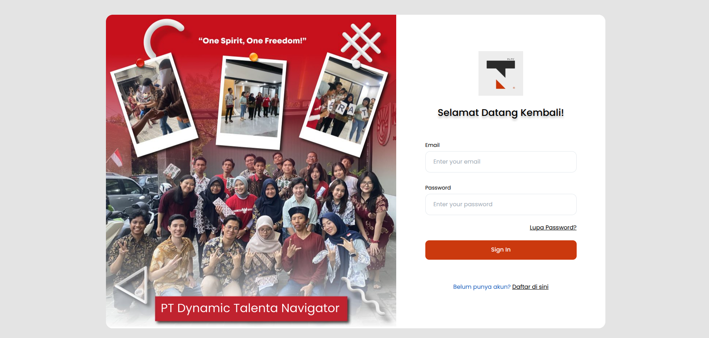
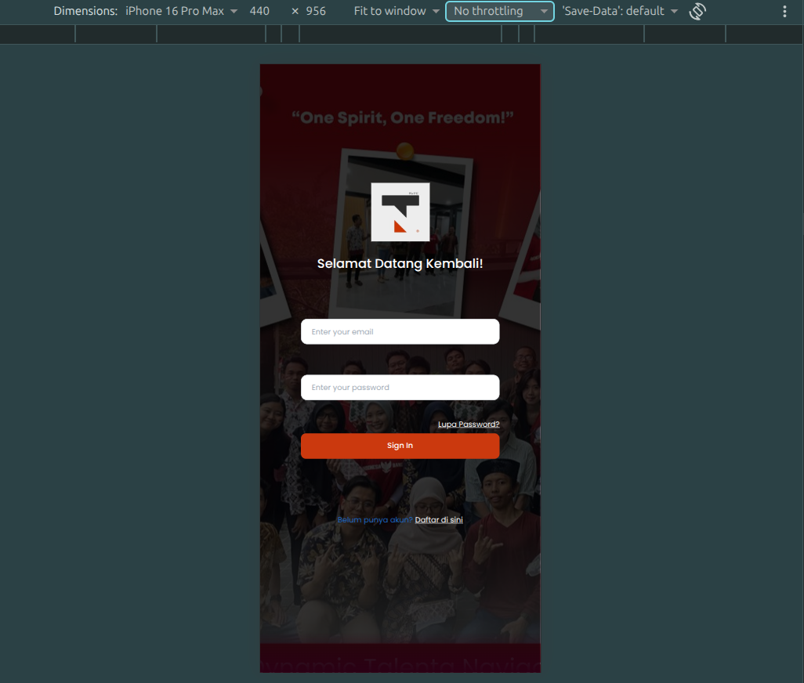
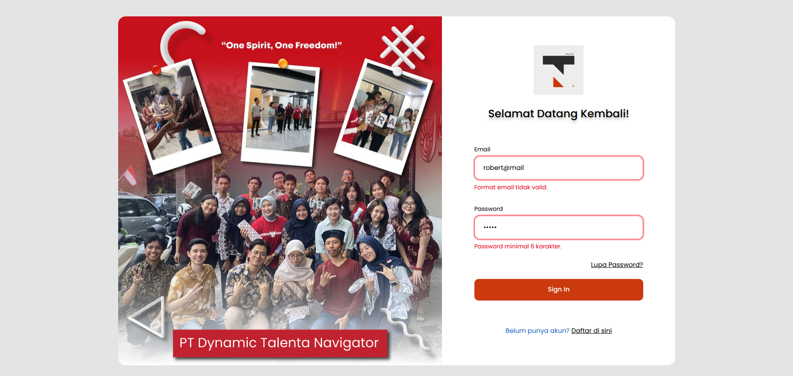
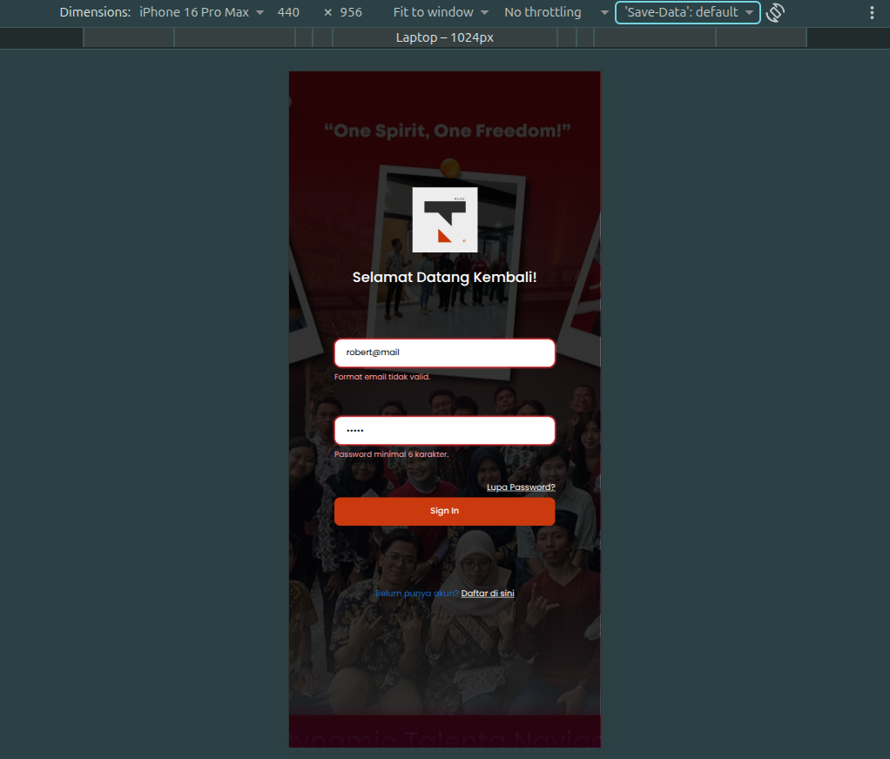
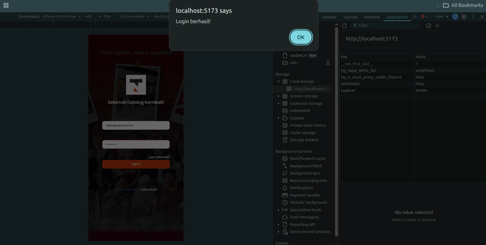
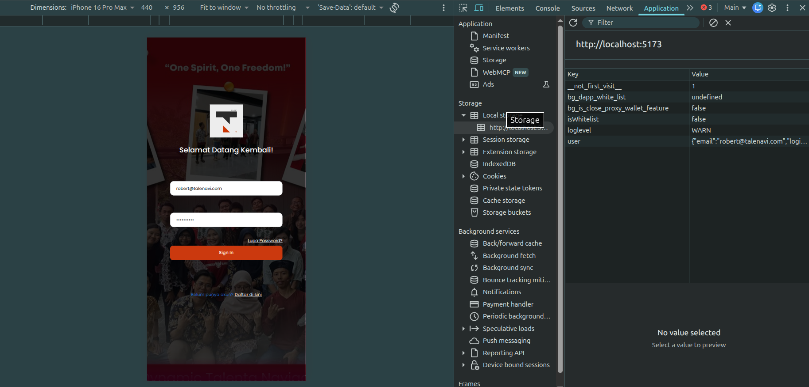
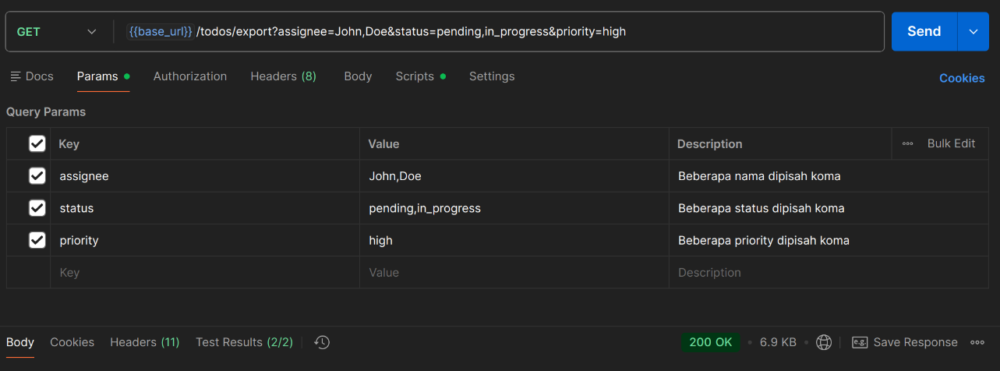
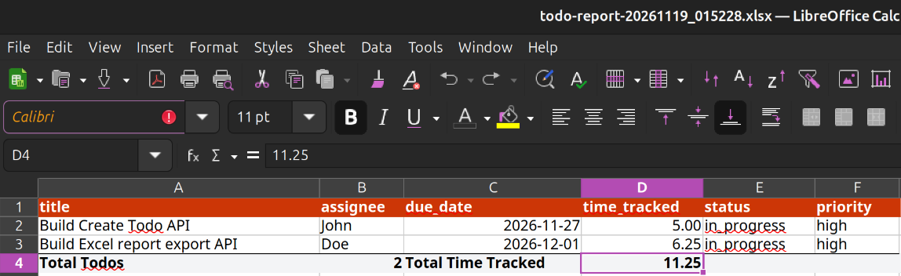

# Technical Test Fullstack — PT Talenavi

Dikerjakan oleh **Robert Aryawan Hartono**.

Repository ini berisi dua bagian technical test:

| Folder | Isi | Stack |
|---|---|---|
| [`frontend/`](frontend) | Slicing **Login Page** (desktop & mobile) + validasi form | React 19, Vite 8, TailwindCSS 4 |
| [`backend/`](backend) | **API Create Todo** & **API Export Excel** dengan filter | Laravel 13, Laravel Excel 4, SQLite |
| [`postman/`](postman) | Postman Collection untuk demo kedua API | Postman Collection v2.1 |

Styling memakai **TailwindCSS** saja, tanpa UI library (Material, Bootstrap, PrimeNG, dsb).

**Video demo (Loom):** https://www.loom.com/share/0fbf132b6d7c4157aa203231960678de

> **Catatan video:** rekaman dibuat di Ubuntu dengan ekstensi Loom untuk Chrome. Kamera dinyalakan selama perekaman, tetapi camera bubble ekstensi Loom hanya tampil saat layar berada di Chrome, sehingga tidak terlihat ketika demo berpindah ke Postman dan VS Code. Ini keterbatasan Loom di Linux ([dokumentasi Loom](https://support.atlassian.com/loom/docs/make-your-camera-bubble-visible-in-loom-recordings/)).

```bash
git clone https://github.com/rbrtary/talenavi-fullstack.git
cd talenavi-fullstack
```

---

## Struktur folder

```
.
├── backend/                         # Laravel 13 (API only)
│   ├── app/
│   │   ├── Enums/                   # TodoStatus, TodoPriority
│   │   ├── Exports/TodosExport.php  # pembuat file Excel + baris summary
│   │   ├── Http/Controllers/Api/TodoController.php
│   │   ├── Http/Requests/           # StoreTodoRequest, FilterTodoRequest (validasi)
│   │   ├── Http/Resources/TodoResource.php
│   │   └── Models/Todo.php          # model + scope filter()
│   ├── database/                    # migration, factory, seeder data contoh
│   ├── routes/api.php
│   └── tests/                       # feature test API & export Excel
├── frontend/                        # React + Vite + Tailwind
│   └── src/
│       ├── pages/LoginPage.jsx      # layout responsif (desktop 2 kolom / mobile 1 kolom)
│       ├── components/              # LoginForm, TextField
│       └── utils/                   # validation.js, session.js (localStorage)
├── postman/Talenavi-Todo-API.postman_collection.json
└── docs/screenshots/
```

---

## Prasyarat

| Tool | Versi |
|---|---|
| PHP | 8.3 atau lebih baru, dengan ekstensi `mbstring`, `xml`, `zip`, `gd`, `sqlite3`, `curl` |
| Composer | 2.x |
| Node.js | 20.19+ atau 22.12+ (syarat Vite 8) |

Contoh instalasi di Ubuntu:

```bash
sudo apt update
sudo apt install -y php-cli php-xml php-mbstring php-zip php-gd php-sqlite3 php-curl php-intl unzip composer

# Node.js (jika `node -v` lebih rendah dari 20.19)
curl -o- https://raw.githubusercontent.com/nvm-sh/nvm/v0.41.0/install.sh | bash
source ~/.bashrc && nvm install --lts
```

---

## Menjalankan Backend (Laravel)

```bash
cd backend
composer run setup     # composer install, .env, APP_KEY, database SQLite, migrate + seed data contoh
php artisan serve      # API berjalan di http://127.0.0.1:8000
```

<details>
<summary>Langkah manual (setara dengan <code>composer run setup</code>)</summary>

```bash
composer install
cp .env.example .env
php artisan key:generate
touch database/database.sqlite
php artisan migrate --seed
```
</details>

Perintah lain:

```bash
php artisan test                 # jalankan semua test
php artisan migrate:fresh --seed # reset database ke 12 data contoh
```

Database default adalah SQLite (tanpa setup server). Untuk MySQL cukup ubah `DB_CONNECTION=mysql` dan kredensial `DB_*` di `.env`, lalu jalankan `php artisan migrate --seed`.

## Menjalankan Frontend (React)

```bash
cd frontend
npm install
npm run dev            # http://localhost:5173
```

`npm run build` untuk build produksi, `npm run lint` untuk lint.

---

## Dokumentasi API

Base URL: `http://127.0.0.1:8000/api`

| Method | Endpoint | Fungsi |
|---|---|---|
| `POST` | `/todos` | Membuat todo baru |
| `GET` | `/todos/export` | Generate & download laporan Excel (`.xlsx`) dengan filter |
| `GET` | `/todos` | *(Bonus)* Daftar todo dalam JSON dengan filter yang sama |

Semua error validasi dikembalikan dalam JSON dengan status `422`.

### 1. Create Todo — `POST /api/todos`

| Field | Tipe | Aturan |
|---|---|---|
| `title` | string | wajib, maks 255 karakter |
| `assignee` | string | opsional |
| `due_date` | date `YYYY-MM-DD` | wajib, **tidak boleh tanggal lampau** (hari ini boleh) |
| `time_tracked` | number | opsional, >= 0, **default `0`** |
| `status` | enum | `pending`, `open`, `in_progress`, `completed`, **default `pending`** |
| `priority` | enum | wajib: `low`, `medium`, `high` |

```http
POST /api/todos
Content-Type: application/json

{
    "title": "Prepare demo for technical test",
    "assignee": "Robert",
    "due_date": "2026-12-31",
    "time_tracked": 1.5,
    "status": "open",
    "priority": "high"
}
```

Response `201 Created`:

```json
{
    "message": "Todo created successfully.",
    "data": {
        "id": 13,
        "title": "Prepare demo for technical test",
        "assignee": "Robert",
        "due_date": "2026-12-31",
        "time_tracked": 1.5,
        "status": "open",
        "priority": "high",
        "created_at": "2026-11-19T10:15:30+07:00",
        "updated_at": "2026-11-19T10:15:30+07:00"
    }
}
```

Contoh error `422` (due_date lampau):

```json
{
    "message": "The due date cannot be in the past.",
    "errors": { "due_date": ["The due date cannot be in the past."] }
}
```

### 2. Export Excel — `GET /api/todos/export`

Semua filter opsional dan bisa dikombinasikan:

| Parameter | Format | Contoh | Perilaku |
|---|---|---|---|
| `title` | string | `title=api` | partial match |
| `assignee` | beberapa string dipisah koma | `assignee=John,Doe` | cocok dengan salah satu nama |
| `start`, `end` | `YYYY-MM-DD` | `start=2026-12-01&end=2026-12-31` | rentang `due_date` (inklusif), boleh salah satu saja |
| `min`, `max` | angka | `min=1&max=8` | rentang `time_tracked` (inklusif), boleh salah satu saja |
| `status` | beberapa enum dipisah koma | `status=pending,in_progress` | cocok dengan salah satu status |
| `priority` | beberapa enum dipisah koma | `priority=low,high` | cocok dengan salah satu priority |

Parameter juga divalidasi: tanggal harus `YYYY-MM-DD`, `end >= start`, `max >= min`, dan nilai `status`/`priority` harus sesuai enum.

Isi file Excel (sheet **Todo Report**):

| title | assignee | due_date | time_tracked | status | priority |
|---|---|---|---|---|---|
| … | … | 2026-12-01 | 3.50 | completed | high |
| **Total Todos** | **12** | **Total Time Tracked** | **25.25** | | |

Baris terakhir adalah **summary row**: jumlah todo dan total `time_tracked` dari data yang sudah difilter.

Contoh hasil dengan data seeder:

| Query | Jumlah todo | Total time_tracked |
|---|---|---|
| *(tanpa filter)* | 12 | 25.25 |
| `title=api` | 4 | 11.25 |
| `assignee=John,Doe` | 6 | 16.00 |
| `start=2026-12-01&end=2026-12-15` | 7 | 15.50 |
| `min=1&max=5` | 7 | 19.00 |
| `status=pending,in_progress` | 7 | 12.25 |
| `priority=low,high` | 8 | 20.00 |
| `assignee=John,Doe&status=pending,in_progress&priority=high` | 2 | 11.25 |

### Postman

Import [`postman/Talenavi-Todo-API.postman_collection.json`](postman/Talenavi-Todo-API.postman_collection.json). Variable `base_url` sudah diisi `http://127.0.0.1:8000/api`.

- Request filter sudah disiapkan; tinggal centang/ubah parameter di tab **Params**.
- Untuk menyimpan file Excel, pilih **Send and Download** (panah di samping tombol Send).
- Setiap request punya test otomatis (lihat tab **Test Results**).

---

## Frontend: Login Page

| Layar | Layout |
|---|---|
| Desktop (`>= 1024px`) | Card dua kolom: banner di kiri, form di kanan. Rasio mengikuti desain Figma (frame 1608px), diskalakan proporsional untuk layar laptop. |
| Mobile (`<= 768px`) | Satu kolom: form di tengah, banner menjadi background dengan overlay gelap. |
| Tablet (`769px – 1023px`) | Memakai layout mobile. |

- Satu markup untuk semua ukuran layar (tanpa duplikasi form); perbedaan layout diatur dengan breakpoint Tailwind `lg:`.
- **Validasi**: email wajib dan berformat valid; password wajib dan minimal 6 karakter. Pesan error tampil di bawah field. Setelah submit pertama, error diperbarui langsung saat mengetik.
- **Login valid**: data disimpan ke `localStorage` dengan key `user`, lalu muncul `alert("Login berhasil!")` dan `console.log("Login berhasil", ...)`.

```json
{ "email": "robert@talenavi.com", "loginAt": "2026-11-19T03:15:30.123Z" }
```

Cek di DevTools → **Application** → **Local Storage** → `http://localhost:5173` → key `user`.

---

## Asumsi & keputusan teknis

- `priority` tidak punya default di soal, jadi dibuat **wajib**.
- `time_tracked` berupa angka desimal >= 0 (contoh: `1.5`).
- Format tanggal API `YYYY-MM-DD`. Timezone aplikasi `Asia/Jakarta`, sehingga "hari ini" pada validasi `due_date` mengikuti WIB.
- Filter `assignee` mencocokkan nama secara utuh (bukan partial); hanya `title` yang partial match.
- Rentang tanggal dan angka bersifat inklusif, dan boleh hanya diisi salah satu batas.
- Kolom `due_date` di Excel disimpan sebagai tanggal Excel asli (bisa di-sort/filter), `time_tracked` diformat 2 desimal.
- Endpoint `GET /api/todos` (JSON) adalah tambahan untuk mengecek hasil filter; filter dan summary-nya sama dengan export.

## Screenshots

### Login Page

| Desktop | Mobile |
|---|---|
|  |  |
|  |  |

| Login berhasil | Data di localStorage |
|---|---|
|  |  |

### Backend

**Request export di Postman**



**Hasil file Excel (dengan summary row)**


